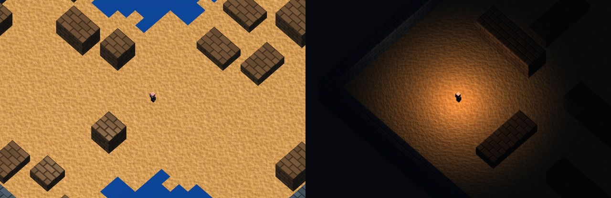

# Member B progress

Verified locally on 2026-11-11 against the team baseline `d40d26c`.

| Project plan | Implementation |
| --- | --- |
| M1 basic arena | A bounded 32³ voxel grid provides collision, player spawn and enemy entry candidates. |
| M2 levels | Day retains the team's noise-generated cover and two water regions (seed 9415). Night has staggered barricades and a south-west start. Both maps have eight enemy entry positions. |
| M2 lighting and materials | Warm directional sunlight by day. At night a point light above the player fades with distance into cool ambient fill. GLSL computes ambient, diffuse and specular components. Sand has a broad, weak highlight, masonry a tighter highlight, and metal projectiles a strong narrow highlight. Water uses the team's Fresnel material. |
| M2 UVs and culling | Sand repeats every four world units. Masonry repeats every two units on the face plane, including vertical faces. The terrain pass submits exposed faces and enables GPU back-face culling for its outward-wound triangles. |
| M3 normal mapping | Sand and masonry sample RGB tangent-space normals on texture unit 1. For each voxel face the shader transforms these directions using the axes of increasing UV and the geometric normal. |

## Replay

Press Enter, select **Night** under **Game menu**, and move the player away from
a barricade. The illuminated area follows the player. Toggle **Surface normal
maps** while standing still beside cover to compare the ground and wall under
the same light. Select **Day** to load the seeded layout again. Restart resets
the timer, weapons, enemies and player spawn on the current map.

Day (left) and Night (right), captured from the scene renderer at each spawn:

## Integration and assets

`makeArenaLayout(level)` supplies collision and spawn data. `selectLevel`
rebuilds the visible geometry and uses the existing gameplay reset, including
enemy animation state. Character skins, instanced zombies and world surfaces
share the scene light. The material pass keeps instance attributes 3–6 and
the existing normal attribute 7.

The sand normal texture uses wrapped height gradients from the team's
`sand_noise_uv.png`. The new masonry colour and normal textures share an
original tiled height field of offset stone courses and recessed joints.
All three new textures ship under `assets/textures/`.

## Verification

- Both production maps pass the connectivity, spawn clearance and enemy entry
  checks. A separate regression checks that their collision layouts differ.
- An OpenGL integration check rendered Day, Night and Day again. Switching
  cleared active enemies and bullets, reset the timer and player spawn, and
  reproduced the initial Day image on return. Restart preserved the Night image.
- With the camera fixed, moving the night light between two floor points
  reversed which point was illuminated. Mean luminance at the first point was
  159 nearby and 10 at distance (8-bit scale). The Day image stayed identical
  when only the supplied player light position changed.
- With fixed geometry and lighting, toggling the normal maps changed samples
  on both the sand and a barricade top. The scene also rendered active zombies
  and projectiles. The CLI benchmark records the level and normal-map setting.
- The team baseline already has six failing gameplay/camera tests. Compare
  against those baseline failures separately. CSE/VLAB verification remains open.
